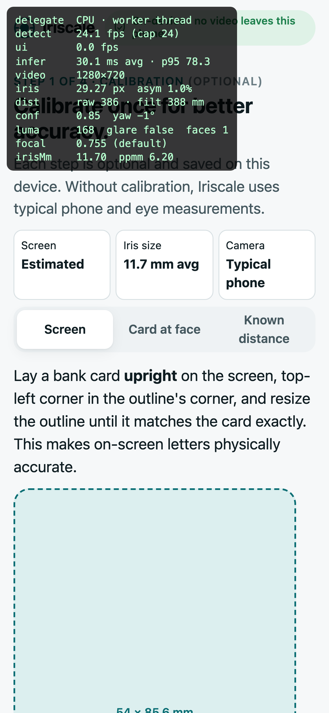
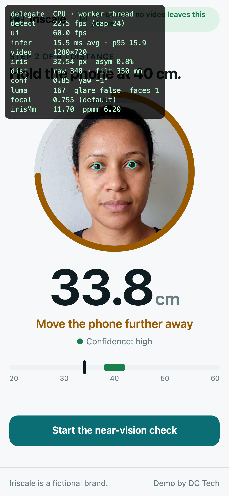
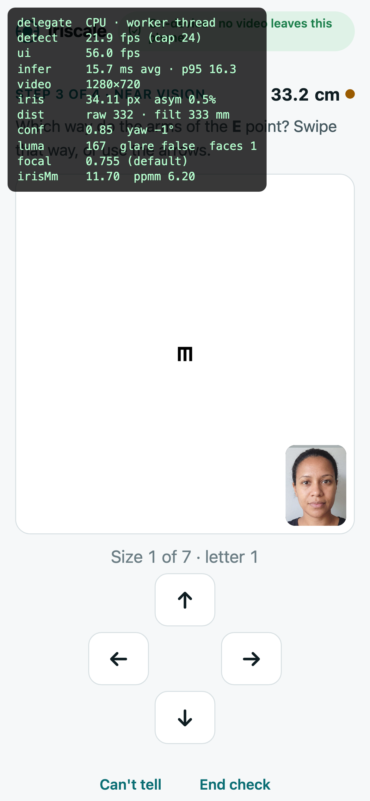
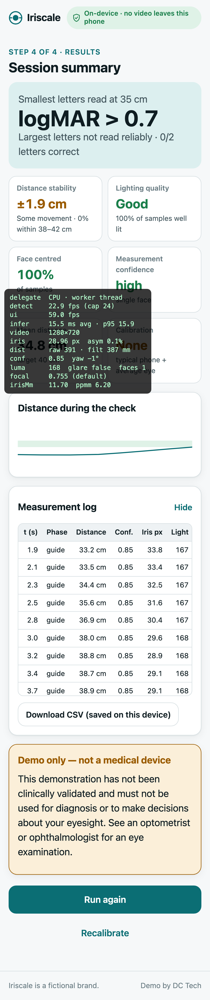

# Iriscale — on-device face-to-phone distance (vision-distance-demo)

A mobile web app that uses the **front camera** to detect a face, measure the iris in pixels and turn it into a **live face-to-phone distance**, then runs a short **tumbling-E near-vision check** with letters drawn at the correct *physical* size for the measured distance. All of the computer vision runs on the phone. **No video or images ever leave the device.**

*Iriscale is a fictional brand. Demo only, not a medical device.*

**Live:** https://vision-distance-demo.vercel.app · add `?debug=1` for the fps / inference overlay

| Calibrate | Distance guide | Near-vision check | Results |
|---|---|---|---|
|  |  |  |  |

<sub>Screenshots come from the automated Playwright run (Chrome fake camera, 390 px, `?debug=1`), and the face is AI-generated. See [Test fixtures](#test-fixtures).</sub>

---

## What it does

1. **Calibrate** (optional, saved per device in `localStorage`)
   - **Screen:** match an on-screen outline to a bank card laid upright on the glass (85.6 mm), which gives true CSS px/mm so letters are physically accurate.
   - **Card at face (option A):** capture a frame with a bank card held flat beside the eye, then drag two lines to the card edges. Card and iris are at the same depth, so `iris_mm = 85.6 × iris_px / card_px`. This measures **your** iris. The captured frame is wiped immediately afterwards.
   - **Known distance (option B):** hold the phone at a tape-measured distance and tap *Calibrate*. This solves for the camera's **focal length** and stores it against the camera's label.
   - **Skip:** falls back to a typical phone front camera (≈67° across the long side) and the population-average iris (11.7 mm).
2. **Distance guide:** "Hold the phone at 40 cm". A ring and ruler turn green inside **38–42 cm**, with a short vibration on Android (`navigator.vibrate`; iOS Safari has no web vibration API). Live warnings cover **low light**, **face off-centre**, **glasses glare**, **head turned** and **multiple faces**.
3. **Tumbling-E check:** Sloan-proportioned E (5×5 grid) at logMAR 0.7 → 0.0. Letter height is recomputed **every frame** from the live distance (`h = 2·d·tan(5·MAR/2)`), so the letter rescales as you move. Answer by swiping, tapping the arrows or using the keyboard arrows. Each level passes on 2 correct and fails on 2 wrong. The check pauses below 30 cm or above 55 cm, and when no face is visible.
4. **Results:** smallest level read (logMAR + 20/x equivalent), distance stability (SD and % within 38–42 cm), lighting quality, % of time the face was centred, mean confidence, which calibration was used, a distance sparkline, the full **measurement log** (5 Hz, with CSV download to the device) and a clear *demo only, not a medical device* disclaimer.

## Architecture

```
index.html ─ 5 screens (welcome · calibrate · guide · check · results), no UI framework
src/
  main.ts                 UI controller: screens, rAF render loop, warnings, E check, results, debug overlay
  styles.css              clinical light/dark theme, big type, prefers-reduced-motion respected
  core/
    camera.ts             getUserMedia({facingMode:'user', 1280×720, ≤30 fps}), mapped error states
    tracker.ts            capped-rate detection loop → TrackerFrame {distance, confidence, pose, quality}
    engine.ts             WorkerEngine: inference in a Web Worker, transferred ImageBitmap in, Float32Array out
    landmark-worker.ts    MediaPipe Face Landmarker (GPU delegate → CPU fallback) in a classic worker
    engine-main.ts        lazy-loaded main-thread fallback engine (same output shape)
    distance.ts           pure math: iris measurement, pinhole distance, calibration, One-Euro filter,
                          confidence, optotype size, pose from the face transform matrix
    optotype.ts           tumbling-E renderer + staircase
    storage.ts            try/catch-wrapped localStorage for calibration only
public/mediapipe/wasm, public/models/face_landmarker.task   self-hosted (no CDN, no third-party requests)
test/                     accuracy + perf harnesses (Playwright), fixtures, results
```

**Two loops, decoupled.** The UI runs on `requestAnimationFrame` at display rate and always renders the *latest* tracker result. Detection runs on `requestVideoFrameCallback` (so the same camera frame is never processed twice), capped at **24 fps** by a credit-based limiter, with back-pressure (one frame in flight). On a slow phone the *detection* rate drops and the UI stays smooth.

**Inference off the main thread.** Each tick does a cheap `createImageBitmap(video)`, which is **transferred** (zero-copy) to the worker. The worker runs `detectForVideo` and writes landmarks and transform matrices into one `Float32Array` that **ping-pongs** between threads, so there's no per-frame allocation. The main thread unpacks it into a fixed array of 478 reused point objects. Luminance and glare sampling use 32×24 and 64×16 scratch canvases allocated once, every 3rd inference. If `OffscreenCanvas`/worker inference isn't available, a lazy-loaded main-thread engine takes over. If the GPU delegate fails at runtime (some Android drivers), it falls back to CPU.

**Lifecycle.** The loop and the video pause on `visibilitychange` (hidden tab), and the filter resets on resume. The model starts downloading, compiling and running a **warm-up inference on a blank frame** (GPU shader compile / graph JIT) as soon as the page opens, in parallel with the user reading the welcome screen. *Start camera* then only has to open the camera, and the screen waits for the first real result so the user never lands on a dead live view.

## The iris method

The visible iris (horizontal visible iris diameter, HVID) is close to constant across adults: **11.7 mm ± ~0.5 mm**. With a pinhole camera model:

```
distance = f_px × 11.7 mm / iris_px
```

- `iris_px` is the horizontal chord of MediaPipe's 4-point iris ring (landmarks 469↔471 and 474↔476), from both eyes. When the eyes disagree (head yaw foreshortens the far iris), the estimate blends toward the larger, less foreshortened one.
- `f_px` is stored **normalised to the frame's long side** (`f_px / max(w,h)`), so one calibration survives resolution changes and portrait/landscape rotation. Default 0.755 (≈67° across the long side).
- Smoothing uses a **One-Euro filter** (min-cutoff 0.8 Hz, β 0.015): low jitter when still, low lag when moving.
- **Confidence** (0–1, shown as high / medium / low) combines iris size in px (quantisation), left/right agreement, head yaw (from the face transform matrix), frame-to-frame noise (residual of raw vs filtered, not motion), light level, glare, and whether the camera is calibrated.

### Why calibration has two parts

A single camera image can't separate the camera's **focal length** from the eye's **real size**. Only their product `f × iris_mm` is observable. So:

- **Card at face** fixes `iris_mm` (your eye) but still relies on the default focal length.
- **Known distance** fixes the product directly, so it corrects both the camera and the person in one step. Done *after* the card step, it yields the true device focal length, which is what gets stored per camera.
- Recommended for the best accuracy: known-distance calibration once per phone, and card calibration once per person.

### Limits (be honest)

- **Anatomy:** HVID varies ~±4 % (1σ) between adults (more in children and some conditions). Uncalibrated, that error passes straight into distance.
- **Unknown focal length:** front-camera field of view varies between phones (~60–80°), and browsers may crop or scale the stream. That's ±10–15 % before calibration. This is the biggest error term.
- **Pixel quantisation:** at 40 cm the iris is ~25–30 px wide in a 720p frame, so ±1 px of landmark error is ±3–4 %. Past ~70 cm (≈16 px) the error grows quickly.
- **Pose, eyelids, glasses:** strong yaw/pitch, squinting, or thick lenses (which magnify or minify the eye: roughly ±1–2 % per dioptre, depending on vertex distance) bias the estimate. Contacts don't.
- **What it measures:** the distance from the **camera** to the **eyes**, not to the screen centre. That's a ~1–3 cm geometric offset at reading distance, which a native app can correct with per-model camera offsets.

## Accuracy

`npm run test:accuracy` runs [`test/accuracy.ts`](test/accuracy.ts) in headless Chromium. Full report: [`test/results/ACCURACY.md`](test/results/ACCURACY.md).

**Method.** Two AI-generated portraits of fictional people. For each, the true iris width is measured on the 2752 px source with an **independent classical method** (limbus edge detection on the luminance profile, visually checked), not with MediaPipe. A virtual phone camera (720×1280, focal `f_true`) then renders the face so the iris spans exactly `f_true × iris_true / d` pixels for d = 25…70 cm, with JPEG compression, three positions per distance and 192 frames in total. The production `measureIris` and `distanceMm` estimate d.

| Scenario | Bias | Mean abs. error | p95 | Max |
|---|---|---|---|---|
| Camera and eye match the defaults (**pipeline error only**) | −0.5 % | **2.1 %** | 3.9 % | 4.0 % |
| **Uncalibrated**, phone focal +10 % and iris 12.2 mm | −13.4 % | **13.4 %** | 16.3 % | 16.5 % |
| Card-at-face calibration only (same mismatch) | −9.7 % | 9.7 % | 11.3 % | 12.8 % |
| **Known-distance calibration** at 40 cm (same mismatch) | +0.6 % | **1.0 %** | 2.7 % | 3.3 % |

Per face, MediaPipe's iris ring measured +4.1 % and −2.0 % against the limbus ground truth. That per-person landmark bias is the main pipeline error, and known-distance calibration absorbs it too.

**What to expect in the real world** (an estimate; this has not been validated on real people):

| | At 40 cm |
|---|---|
| No calibration | typically **±5–15 %** (±2–6 cm), dominated by the phone's unknown field of view and the person's iris size |
| Card calibration only | removes the iris term, leaving the camera term: **±5–12 %** |
| Known-distance calibration | **±2–4 %** (≈±1–1.5 cm), limited by landmark precision, pose and how accurately the reference distance was measured |

The synthetic test doesn't model lens distortion, autofocus breathing, motion blur, real sensor noise, head pose, glasses or real iris variation. **The next step for a product is a real-subject study**: N people × M phones, with tape-measured ground truth at 30/40/50 cm, reported per phone model.

## Performance

`npm run test:perf`: Playwright on the production build, **390×844 @ DPR 3**, Chrome fake camera fed a 1280×720 face video ([`test/make-fake-video.sh`](test/make-fake-video.sh) sweeps the face scale to simulate 33–48 cm), **CPU throttling 4×** via CDP. Each run walks the full flow (calibrate → guide → E check → results). Full report: [`test/results/PERF.md`](test/results/PERF.md).

| Config (4× CPU throttle) | Detection fps | Inference avg | UI fps | Long tasks / 15 s |
|---|---|---|---|---|
| **Worker + CPU delegate** | 22.4 | 15.5 ms | **59.8** | **0** |
| Worker + "GPU" delegate (SwiftShader) | 13.6 | 46.1 ms | **60.0** | **0** |
| Main thread + CPU (old architecture) | 11.0 | 74.0 ms | 21.7 | 175 |
| Main thread + "GPU" (old architecture) | 13.0 | 67.5 ms | 17.3 | 200 |

- Moving inference to a worker took the UI from **~17–22 fps to 60 fps** at 4× throttle, with zero long tasks.
- Caveats: headless Chromium has no real GPU (the GPU delegate is software-emulated and slower than CPU here), and CDP throttling doesn't slow worker threads. The **main-thread 4× inference time (~45–75 ms) is the better proxy** for a mid-range Android phone. Expect ~13–20 fps detection there, with the UI unaffected.
- Payload: app JS **33 kB** (13 kB gzip) + CSS 12 kB. Measured on the live site, the one-time downloads are the MediaPipe wasm (14.5 MB raw, **3.9 MB** compressed) and the face model (**3.3 MB** transferred), both cached for 7 days. A cold start on the live site (download + model warm-up, headless test machine in Lagos → Vercel fra1) took ~24 s. On a fast connection with a real GPU expect ~3–8 s, and repeat visits skip the download.
- **Warm-up:** time from tapping *Start camera* to the live screen (user spends 4 s on the welcome screen first, same machine, no network): **5.9 s → 1.3 s** after moving model download, compile and the warm-up inference to page load.
- Live check: the full flow (calibrate → guide → E check → results) passes on the production URL with the strict CSP active (worker + wasm load fine): 22.5 fps detection, 60 fps UI, 0 long tasks at 4× throttle.

## Privacy approach

- **On-device only.** Camera frames go from `getUserMedia` → `<video>` → `ImageBitmap` → the worker → landmarks. Nothing is encoded, recorded, uploaded or persisted. Option A's captured frame lives in a canvas until you save, then it's cleared.
- **The browser enforces it.** The page is served with `Content-Security-Policy: default-src 'self'; connect-src 'self' blob: data:` (see [`vercel.json`](vercel.json)), and the site is static with no API routes, so the page can't send data to any third party. The model and wasm are **self-hosted** (no Google CDN), with no cookies and no third-party scripts. `Permissions-Policy` allows only the camera.
- **Analytics:** the deployment uses Vercel Web Analytics, which is first-party (`/_vercel/insights` on this origin) and cookieless, and counts page views only. It never touches the camera, frames, landmarks or measurements. Remove `inject()` in `src/main.ts` to turn it off.
- **What's stored:** only calibration numbers (focal length, iris mm, screen px/mm, camera label) in `localStorage`, wrapped in `try/catch` so private mode and blocked storage still work. *Reset saved calibration* clears it. The measurement log stays in memory, and *Download CSV* saves it to the device only.
- **HIPAA framing:** because no PHI or images reach a server, this architecture keeps the vision step outside the server-side HIPAA scope. A production app that syncs results would add a BAA-covered backend, sending only **derived numbers** (distance, scores) and never imagery, with explicit consent, encryption in transit and at rest, and audit logging.

## How this maps to a native iOS / Android app

The math in [`src/core/distance.ts`](src/core/distance.ts) is pure and framework-free, and it ports 1:1.

| Web demo | React Native | Fully native |
|---|---|---|
| `getUserMedia` | **react-native-vision-camera** (front device, 30 fps, `pixelFormat: 'yuv'`) | AVCaptureSession / CameraX |
| MediaPipe Tasks (wasm, worker) | VisionCamera **frame processor** (worklet thread) + MediaPipe Face Landmarker via a native plugin, or **ML Kit Face Mesh** (468 pts, no iris: add the MediaPipe iris model) | MediaPipe Tasks iOS/Android (`FaceLandmarker`, GPU delegate) |
| Default focal (67° FOV) | **Real intrinsics**: iOS `AVCameraCalibrationData.intrinsicMatrix` / `cameraCalibrationDataDeliveryEnabled`, Android `LENS_INTRINSIC_CALIBRATION` / `LENS_INFO_FOCAL_LENGTH` + `SENSOR_INFO_PHYSICAL_SIZE` | same |
| Iris-only depth | TrueDepth (Face ID iPhones) gives metric depth directly, and ARKit `ARFaceAnchor` gives eye transforms. Use them as ground truth or a fusion input where available | same |
| Worker + transferable buffers | worklets + shared memory (JSI), zero-copy frame access | native threads |
| `navigator.vibrate` | `expo-haptics` / UIImpactFeedbackGenerator (iOS gets haptics too) | same |
| CSS px/mm calibration | `PixelRatio` + per-device physical DPI (`xdpi/ydpi` on Android, model table on iOS); card calibration as a fallback | same |

Native mostly makes calibration unnecessary: real camera intrinsics remove the largest error term, leaving the iris (±4 %) and landmark terms. Adding an optional one-time card calibration would bring a native app to roughly ±2–3 % at reading distance.

**Future CV / AI features** that slot into the same tracker: blink rate and eye-strain (blendshapes are already supported by the model), screen-time-at-distance monitoring (myopia-risk coaching for children), pupil/iris tracking for gaze, ambient-light assessment, and on-device personalised models. Imagery stays local; only derived metrics go out.

## Development

```bash
npm install
npm run dev              # https needed on a phone: use a tunnel or `vite --host` + a trusted cert
npm run build            # → dist/
npm run test:accuracy    # synthetic known-distance accuracy → test/results/ACCURACY.md
npm run test:perf        # Playwright perf matrix at 390 px, CPU 4× → test/results/PERF.md
```

URL flags: `?debug=1` (overlay), `?cpu=1` (force CPU delegate), `?main=1` (force main-thread inference), `?fps=15` (detection cap).

### Test fixtures

`test/fixtures/face1.jpg` and `face2.jpg` are **AI-generated portraits of fictional people** (Gemini 3 Pro Image). They are not real persons, so there are no likeness or licensing issues. The fake camera video is generated from them by ffmpeg.

### Stack

Vite + TypeScript, no UI framework, no runtime dependencies other than `@mediapipe/tasks-vision`. Hosted on Vercel as a static site.

---

Demo by [DC Tech](https://dctechltd.com)
